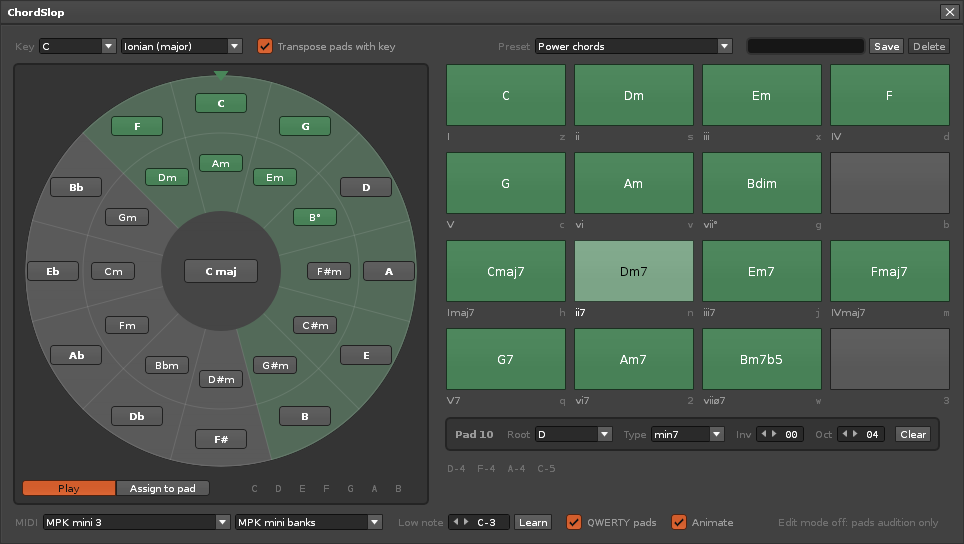

# ChordSlop

Chord pads for [Renoise](https://www.renoise.com) with a circle of fifths that
turns to the key you are in. Sixteen pads, playable from the mouse, a MIDI
controller or the QWERTY keyboard, recording straight into the pattern editor.



The tool itself lives in [`com.dac514.ChordSlop.xrnx/`](com.dac514.ChordSlop.xrnx/);
its [README](com.dac514.ChordSlop.xrnx/README.md) is the user guide. Everything else
in this repository is development tooling from the
[ReSlop](https://github.com/dac514/reslop) kit: a `justfile`, `scripts/renoise.py`,
the vendored Renoise API definitions, and unit tests.

## Install

Download the `.xrnx` from the
[releases page](https://github.com/dac514/chordslop/releases) and drag it onto
Renoise, or use the version on renoise.com once it is published.

## Develop

```
just doctor      # check stylua, lua-language-server, luajit, Renoise, the dev bridge
just check       # formatting + types (+ Renoise's own parser when Renoise runs)
just test        # unit tests under plain LuaJIT, no Renoise needed
just install     # install into the running Renoise
just reload      # reinstall after edits
just package     # dist/com.dac514.ChordSlop.xrnx
```

The music theory, pad model, circle geometry, MIDI/QWERTY decoding, recording
placement and presets are pure Lua modules under `src/` with tests in `tests/`.
Only `app.lua`, `ui.lua`, `player.lua`, `store.lua` and `anim.lua` talk to Renoise.

See [CLAUDE.md](CLAUDE.md) for the full development notes.

## License

MIT, see [LICENSE](LICENSE).
